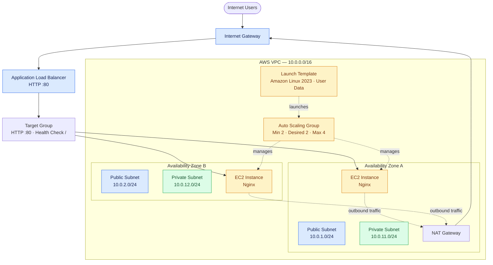
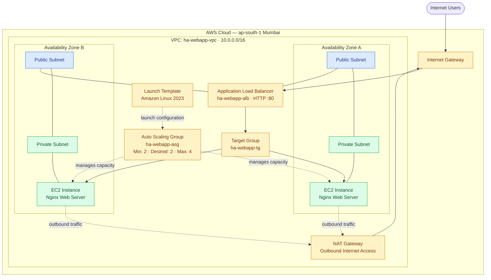

# AWS High-Availability Web Application Architecture

## 1. Overview

This project uses AWS networking, load balancing, and EC2 Auto Scaling components to build a web application infrastructure across two Availability Zones.

## 2. Network Design

| Resource | Configuration |
|---|---|
| VPC | `10.0.0.0/16` |
| Public subnet A | `10.0.1.0/24` |
| Public subnet B | `10.0.2.0/24` |
| Private subnet A | `10.0.11.0/24` |
| Private subnet B | `10.0.12.0/24` |

## 3. AWS Components

- **VPC:** Isolated network for project resources.
- **Public subnets:** Host the internet-facing load balancer and NAT Gateway.
- **Private subnets:** Host application EC2 instances.
- **Internet Gateway:** Enables internet connectivity for public resources.
- **NAT Gateway:** Provides outbound internet access for private instances.
- **Application Load Balancer:** Routes HTTP requests to registered targets.
- **Auto Scaling Group:** Maintains the configured EC2 capacity.
- **Launch Template:** Defines the EC2 instance configuration.
- **IAM role:** Provides permissions for Systems Manager access.
- **Security groups:** Restrict network traffic.

## 4. Traffic Flow

1. A user sends an HTTP request to the Application Load Balancer.
2. The ALB forwards requests to registered EC2 targets.
3. Nginx on an EC2 instance serves the sample web page.
4. Private instances use the NAT Gateway for outbound connectivity when needed.

## 5. Security

- ALB security group permits inbound HTTP traffic.
- EC2 security group permits HTTP traffic from the ALB security group.
- Application instances are configured in private subnets without public IP addresses.
- EC2 instances use an IAM role instead of embedded credentials.

## 6. Availability Considerations

The ALB and Auto Scaling Group are configured to use subnets in two Availability Zones. The project uses a single NAT Gateway to control costs; this introduces an outbound-connectivity and Availability Zone dependency.

## 7. Validation

The target group previously reported health-check timeouts. Confirm target health and application accessibility before claiming that the deployment is fully operational.

# AWS High-Availability Web Application Architecture

# AWS High-Availability Web Application Architecture

## Overview

This project deploys a highly available web application on AWS in the Mumbai region (`ap-south-1`). An Application Load Balancer distributes incoming HTTP traffic across private EC2 instances deployed in two Availability Zones. An Auto Scaling Group maintains application capacity, while a NAT Gateway provides outbound internet connectivity to private instances.

## Architecture Diagram

## AWS Services Used

- Amazon VPC and subnets
- Internet Gateway and NAT Gateway
- Application Load Balancer and Target Group
- Amazon EC2 and Launch Template
- Auto Scaling Group
- Security Groups and IAM roles

## Traffic Flow

1. Users send HTTP requests to the public Application Load Balancer.
2. The load balancer forwards requests to healthy registered EC2 targets in private subnets.
3. The Auto Scaling Group manages EC2 capacity across the Availability Zones.
4. Private instances use the NAT Gateway for outbound internet access when required.

## Availability and Security

- Application instances are distributed across two Availability Zones.
- The load balancer provides a single public entry point.
- Private EC2 instances are not intended to receive direct public internet traffic.
- Security Groups restrict access between the load balancer and application instances.
- The Auto Scaling Group can replace unhealthy instances and adjust capacity.

> Note: This diagram represents the intended architecture. Confirm the deployed subnet associations, NAT routing, target health, and security group rules against your AWS environment.
